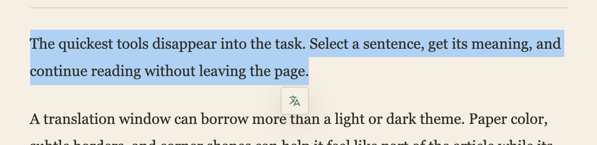
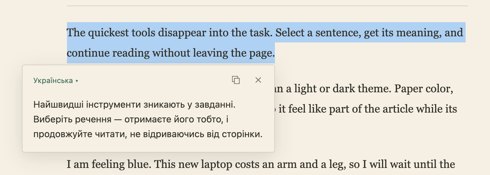
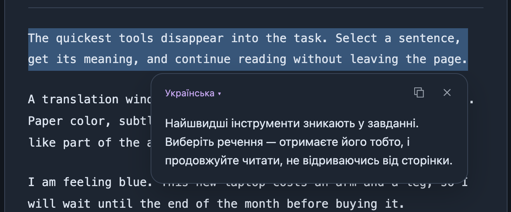
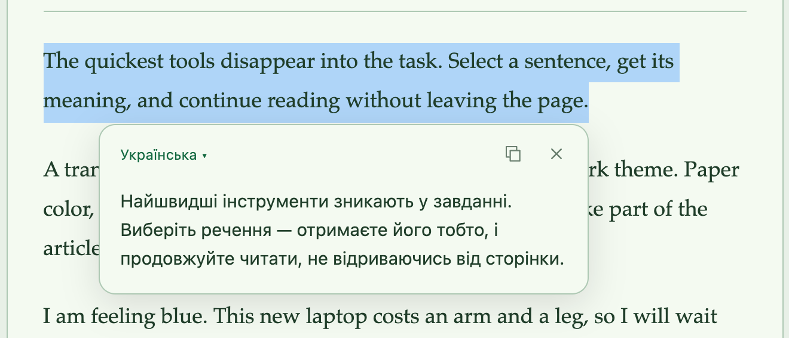
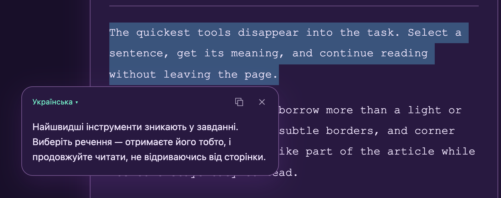
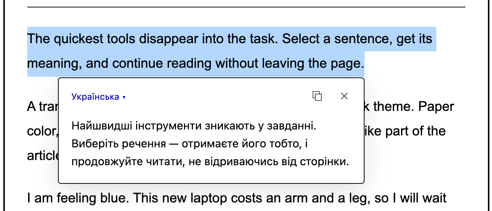

# Shvyd

Shvyd translates the text you select, in a small popup next to it, so you never leave the page. It works in any Chromium browser.

**[Download the latest release](https://github.com/Zheckan/shvyd/releases/latest)** and follow the [install steps](#install).

The popup takes its look from the page you're reading, so it looks like part of the site. Of the translators I've tried, it's the quickest way to read a sentence in another language and carry on.

> [!NOTE]
> I built Shvyd quickly as a personal project, so expect rough edges. If something breaks or looks wrong, [open an issue](https://github.com/Zheckan/shvyd/issues) with the page and what you selected.

## Select text and click the button

Select text on any page, and a small button appears next to it.



Click it, and the translation opens beside the selection.



From there you can:

- Pick another language from the menu in the popup's top bar. Your preferred languages come first, and **More languages** searches the rest.
- Copy the translation, drag the popup by its top bar, or resize it from any edge.
- Keep the structure of what you selected. Paragraphs, headings, lists, tables, and underlined links stay intact, and code stays untranslated.
- Click the Shvyd icon in the toolbar to switch languages, turn Shvyd off for the current site, or open **All settings**.

Nothing is sent until you click the button.

## It adapts to every page

Shvyd reads the colors, border, and corner shape around the selection and styles the popup to match. It checks that the text stays readable before using them. To get a plain popup everywhere instead, turn off page adaptation in settings.

| Dark code page                                            | Green paper                                                         |
| --------------------------------------------------------- | ------------------------------------------------------------------- |
|  |              |
| **Neon**                                                  | **High contrast**                                                   |
|       |  |

## Install

1. Download `shvyd-<version>.zip` from the [latest release](https://github.com/Zheckan/shvyd/releases/latest) and unzip it into a folder you'll keep. The browser loads Shvyd from there.
2. Open `chrome://extensions` and turn on **Developer mode**.
3. Click **Load unpacked** and choose the unzipped folder.
4. Reload any open page, select some text, and click the button.

To update, replace the files in that folder with the new release and click the reload icon on Shvyd's card in `chrome://extensions`. Your settings stay. [Install, update, and roll back](docs/install.md) has the details.

To build it yourself, run `bun install` and `bun run build`, then load the `dist` folder the same way.

## Translation works without a key, but bring your own for reliability

Out of the box, Shvyd translates through Azure Translator using a shared relay that I run. You don't need an account or a key, and the limit is generous enough for everyday reading.

The relay is not a reliable service, though. Everyone shares one free Azure quota of 2 million characters a month, and each IP address gets 20 requests a minute. When the quota runs out, translations fail until it resets. I don't promise it stays up.

For translation you can rely on, add your own Azure key. Azure's free tier gives you 2 million characters a month of your own.

1. Sign in to the [Azure portal](https://portal.azure.com/). A new account may ask for phone and card verification.
2. Create a resource group, then create a **Translator** resource in it. Choose **Global** as the region and **F0** as the pricing tier.
3. Open the resource, then **Keys and Endpoint**, and copy **Key 1**.
4. In Shvyd, click the toolbar icon and open **All settings**.
5. Paste the key into **Your Azure API key**. Leave **Location code** empty for a Global resource.
6. Click **Test connection**. Settings save as you change them.

With your key set, Shvyd calls Azure directly instead of going through the relay. Delete the key to go back to the shared relay. [API key setup](docs/api-keys.md) covers each Azure step in more detail.

DeepL is optional and needs your own key. Its free API plan gives 1 million characters in total, not per month. Paste the key into **Your DeepL API key**, then choose DeepL under **Translate with**.

Your keys stay in the extension's own storage. Pages you visit never see them, and Shvyd builds contain no keys. See the [privacy policy](PRIVACY.md) for what is sent where.

## Limits

- One selection can be up to 10,000 characters.
- Shvyd doesn't run on browser pages such as `chrome://` and the Chrome Web Store, or in the built-in PDF viewer. Password fields never offer translation.
- On pages with image backgrounds or unusual layouts, the popup may pick colors that don't fit. Turn off page adaptation there, or [report the page](https://github.com/Zheckan/shvyd/issues).

## Development

```sh
bun install
bun run dev      # playground with the popup at http://localhost:5173
bun run fix      # apply lint fixes and formatting, then verify
bun run verify   # lint, format check, typecheck, unit tests, and build
```

The playground calls Azure and DeepL with the keys in `.env`. Copy `.env.example` to start.

The browser checks run in [Helium](https://helium.computer/) in a temporary profile and need Python's `websocket-client`. Results and screenshots go to `.preview/`.

| Command                              | Also needs                                     | Checks                                                      |
| ------------------------------------ | ---------------------------------------------- | ----------------------------------------------------------- |
| `bun run test:popup`                 | Nothing                                        | Button placement, popup size, scrolling, resizing           |
| `bun run test:reliability`           | Nothing                                        | Retries, error messages, worker restarts, usage counts      |
| `python3 scripts/check-demo.py`      | `bun run dev`, keys in `.env`                  | Formatting, partial selections, safe HTML, copying          |
| `python3 scripts/check-extension.py` | `bun run build`, `bun run dev`, keys in `.env` | Both providers live, eight page styles, languages, dragging |

CI runs `bun run verify` and the Python benchmark tests on every pull request. [AGENTS.md](AGENTS.md) describes the project layout and conventions.

## More documentation

- [Changelog](CHANGELOG.md)
- [Install, update, and roll back](docs/install.md)
- [Selection formatting](docs/formatting.md)
- [Language choices](docs/languages.md)
- [Local usage counts and error records](docs/local-usage.md)
- [Shared Azure relay](docs/shared-azure.md)
- [Request reliability and caching](docs/translation-reliability.md)
- [Releasing](docs/releasing.md)
- [Provider comparison and benchmarks](docs/translation-options.md)
- [Future ideas](docs/future.md)
