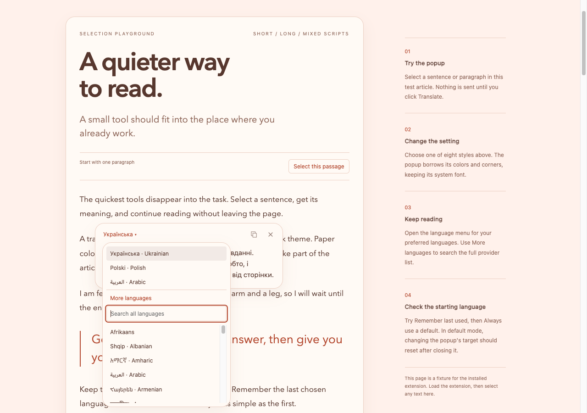
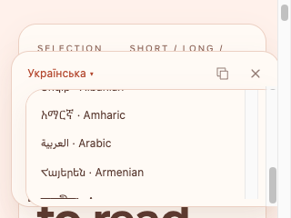

# Language popover verification

Verified on 2026-10-03 in isolated Helium profiles. The regular browser profile was left alone.

Opening the original preferred-language menu increased the translation window from 95 px to 244 px in the controlled short-text sample. Moving the menu into its own floating layer removed that layout change. The menu now positions itself from the language button, opens above or below it, and limits its height to the available space.

A 320 × 240 resize also made Chromium scroll the source page during reflow. That scroll originally dismissed both windows. The popup now handles reflow scrolling during the resize frame by updating its position. Deliberate page scrolling still dismisses the translation and its language menu.

## Checks

- `pnpm fix` passed lint, formatting, TypeScript, all 17 prototype behavior tests, and a credential-free build. `pnpm build:local` restored the private extension build afterward.
- `python3 scripts/check-extension.py` passed 33 checks against the unpacked extension, including live Azure and DeepL requests, all eight page styles, both target-language modes, selection formatting, and the new resize checks.
- The language popover stayed visible, anchored with a 6 px gap, and inside the viewport while resizing from 1280 × 900 to 390 × 520, then 320 × 240, and back to desktop size. The shortest viewport kept the menu scrollable. A subsequent page scroll dismissed both popups.
- Preferred-language opening, additional-language expansion, and searching kept the translation window's bounds unchanged in the extension checks.
- `python3 scripts/check-demo.py` passed 17 checks. Five use live translations and twelve use controlled responses. The seven new menu checks cover stable window bounds, searching, arrow-key navigation, Escape and focus return, clicking the translation, and choosing another language.

The shared browser preview reproduced the original height change and passed the initial stable-layout check. It disconnected during later resize testing. The completed results and screenshots below come from the isolated Helium runs.

The regression in `tests/browser/language-menu.js` runs through the public popup UI from `scripts/check-demo.py`. It controls translation responses and public preferences without persisting those test preferences. The installed-extension check verifies actual provider requests separately.

## Evidence

- [Extension results](extension-results.json)
- [Demo results](demo-results.json)

The menu overlays the page independently of the translation window:

In a short viewport, the menu scrolls within the available space:

