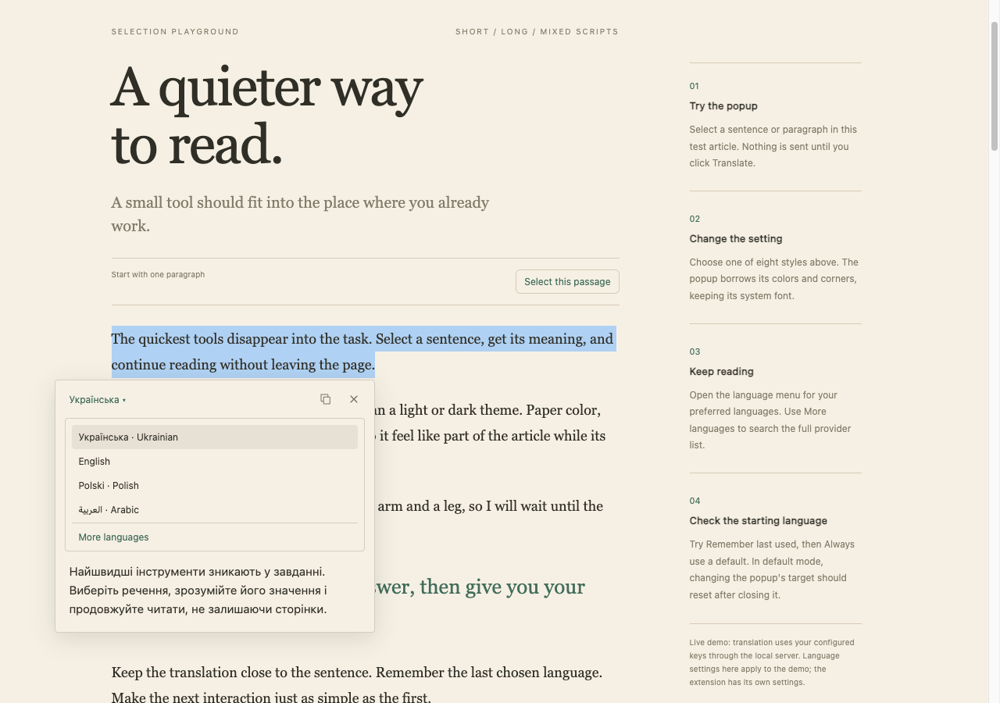
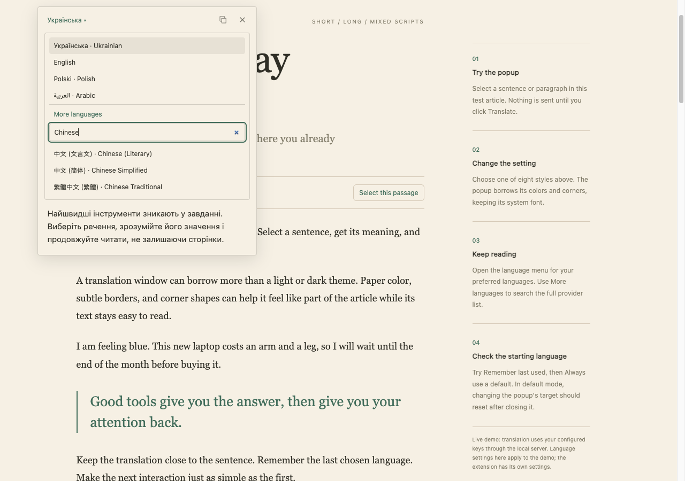
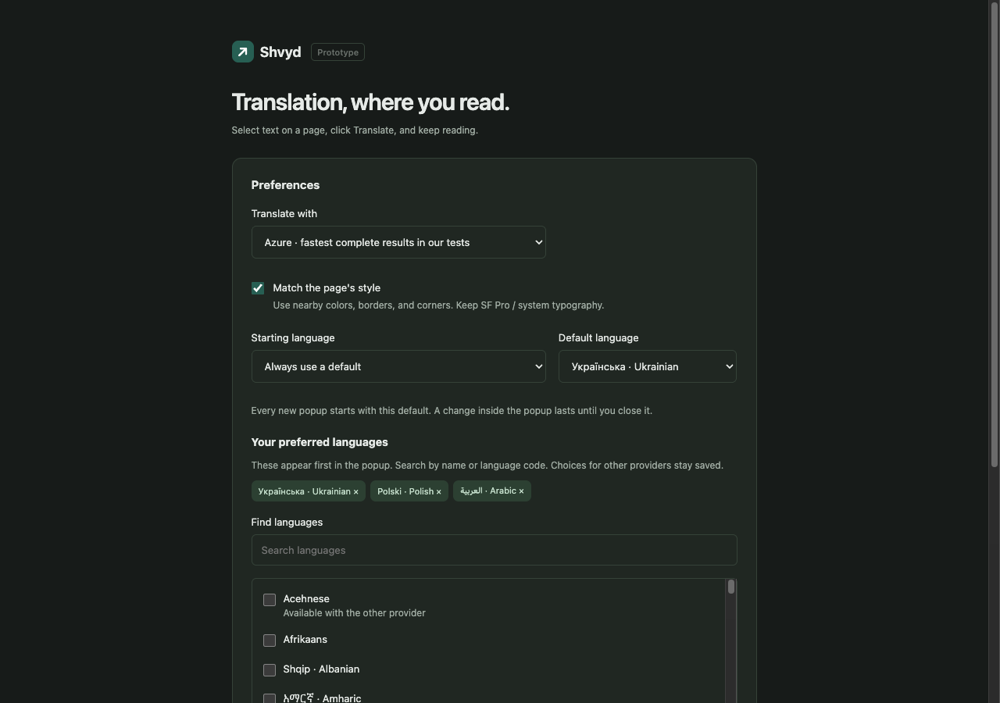

# Languages and playground verification, 2026-10-03

The prototype now bundles 173 target entries from the current provider catalogs: 138 Azure targets and 126 DeepL targets. It offers preferred languages, a searchable additional-language menu, and separate remembered or fixed starting-language modes. The [language guide](../../../languages.md) describes the settings and fallback rules.

## Installed extension

The actual unpacked extension passed 24 checks in an isolated, headless Helium profile. The fixture omitted the demo's translator script, so selection, translation, and saved settings used the extension content script, background worker, and options page. Both configured provider keys were present; the results contain only presence booleans.

| Coverage | Result |
|---|---|
| Eight page styles | Editorial, technical, journal, warm, forest, contrast, neon, and gradient all translated to Ukrainian with fixed SF Pro / system typography, 15 px translation text, and normal spacing |
| Remember last used | Choosing Polish persisted across page navigation |
| Fixed default | Starting with Ukrainian, temporarily choosing Arabic, and closing the popup returned the next popup to Ukrainian; navigation also reset the temporary choice |
| Preferred languages | Ukrainian, Polish, and Arabic stayed selected after revisiting settings |
| Additional languages | Search found Traditional Chinese and produced a complete translation; disabling the additional menu hid it |
| Keyboard | Escape first closed the language menu while retaining the popup, and closed the popup when the menu was already closed |
| Long selection | The completed translation remained inside the viewport and used an internal scroll area |
| Faint source text | The popup replaced the poor source contrast with readable black text |
| Nested dark card | The popup used the card's dark background and mint link accent |
| DeepL | Ukrainian and Hindi translations completed through the configured official endpoint |
| Provider filtering | DeepL settings exposed its 126 targets |
| Narrow viewport | The popup remained within a 390 × 844 viewport |

Raw observations, including synthetic source translations and computed styles, are saved in [extension-results.json](extension-results.json).

An earlier pass exposed the nested-card accent bug. Another initial assertion caught small color differences introduced by canvas conversion. The sampler now reads standard computed RGB values directly and finds link accents in the nearest container. The final 24-check pass used those fixes.

## Live demo

The standalone live demo passed five separate checks in an isolated Helium profile without loading the extension: settings save confirmation, starting with the fixed Ukrainian default, temporarily translating to Arabic, resetting to Ukrainian after closing, and searching the additional languages. See [demo-results.json](demo-results.json).

The collaborative browser also verified the demo settings form and its save confirmation. Its snapshot tool did not return a screenshot, so the screenshots here came from the isolated Helium runs. A demo-specific browser-global naming collision was corrected by wrapping the generated script in an IIFE. Initial headless attempts needed a short stabilization period after page load; only the completed pass is counted here.

## Other checks and limits

- Strict TypeScript checking, 13 prototype behavior tests, and the credential-free build passed.
- All 17 existing Python benchmark tests passed.
- The final local build contains the existing private Azure/DeepL bootstrap settings in an ignored file. The standard build contains no credentials.
- No runtime package dependencies were added. The minified content script is about 36.5 KiB; background and settings scripts are about 23.8 and 27.8 KiB.
- Small English-source DeepL probes to Hindi, Arabic, Traditional Chinese, and Aymara returned HTTP 200 with `latency_optimized`. These were eligibility spot checks, not latency benchmarks.

The catalog does not establish translation quality for every language pair. These runs also do not establish arbitrary-site compatibility, physical memory use, or a live browser-restart result. Gradient and image colors are approximated from the declared solid colors and alpha compositing; the sampler does not read the painted image or gradient underneath a selection. Neutral styling remains available.

## Screenshots

Preferred languages:



Additional-language search:



Default-language and preferred-language settings:



Also saved: [Arabic output](arabic-target.png), [long translation](long-translation.png), [technical page](technical.png), and [editorial page](editorial.png).

## Repeat

Start `bun run dev` with the configured provider keys. In another terminal:

```sh
bun run check
bun run build:local
python3 scripts/check-extension.py
python3 scripts/check-demo.py
```

The checks use the existing `websocket-client` dependency. Local results go to `.preview/extension-check` and `.preview/demo-check`. The demo check changes the demo's preferences; it leaves the installed extension settings and regular browser profiles alone. Preserve this dated evidence when saving later comparisons. Headless stabilization and completion polling make these functional checks unsuitable for provider latency ranking.
