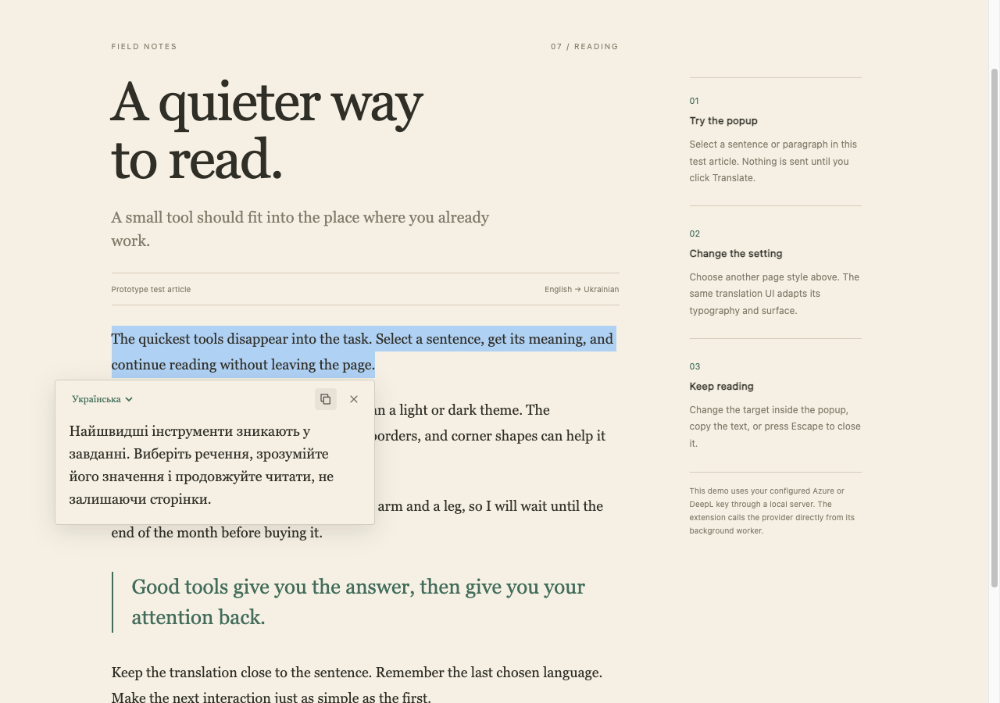
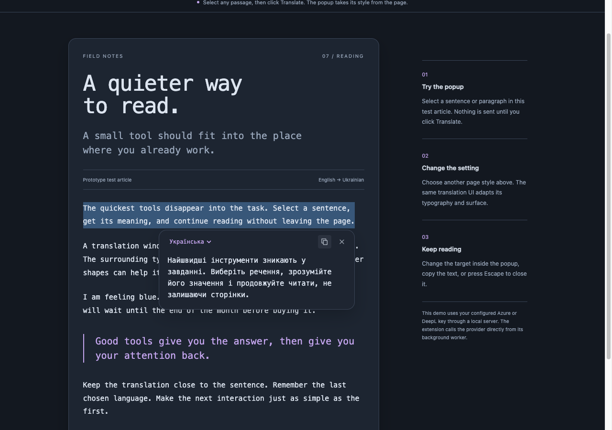

# Chromium prototype verification, 2026-10-03

The unpacked Manifest V3 extension ran successfully in an isolated, headless Helium profile on this Mac. Both Azure and DeepL returned translations through the extension's background worker. The normal browser profile was not changed.

## Checks completed

| Check | Observed result |
|---|---|
| Editorial page | Georgia type, cream surface, green accent, 4 px corners; Ukrainian translation |
| Technical page | Monospace type, dark card surface, purple accent, 16 px corners; Ukrainian translation |
| Journal page | Arial type, white card surface, blue accent, 8 px corners; Ukrainian translation |
| Warm page | Avenir / system type, warm card surface, 20 px corners; Ukrainian translation |
| Remembered target | Changing Ukrainian to Polish in the popup persisted across page navigation |
| Provider setting | Switching to DeepL through the extension's options page produced a complete Ukrainian translation |
| Narrow window | The popup stayed within a 390 × 844 viewport |
| Keyboard dismissal | Escape closed the popup |

The selection button was clicked through browser mouse events. Each page-style check required a nonempty completed translation, the expected target, and a popup within the viewport. The fixture omitted the demo's injected script, so these checks used the actual installed extension content script and worker.

The first observed Azure click-to-complete time was 301.8 ms. The DeepL check was 475.2 ms. These are individual functional observations with 50 ms completion polling, not latency medians or a new provider ranking. Later page-style checks reused the same source and could benefit from the extension's in-memory cache. Rendering and browser automation overhead are included.

## Other validation

- Strict TypeScript check passed.
- Seven prototype behavior tests passed, covering Azure's actual response envelope, DeepL speed mode, target-specific caching, credential-safe authentication errors, persisted preferences, and missing or denied clipboard access.
- All 17 existing Python benchmark tests passed.
- The credential-free build completed. The minified content script was about 16 KiB; background and settings scripts were about 7 to 8 KiB each. There are no runtime package dependencies.
- The local private build imported the existing Azure and DeepL settings without exposing keys in the source, screenshots, or public results.

The first live Azure attempt exposed an incorrect array-only test fixture. The fixture and parser were corrected to the documented `value` envelope, and the live test then passed. See the [Azure response contract](https://learn.microsoft.com/en-us/azure/ai-services/translator/text-translation/2026-06-06/translate-api).

The automated browser harness was also corrected to wait for the new document on repeated navigation and for credential initialization. The successful functional pass is saved in [results.json](results.json). This pass does not establish translation accuracy, performance across arbitrary websites, physical RAM use, or browser restart behavior.

The clipboard fallback was added after this runtime pass. Later optional browser attempts did not complete and are excluded from the successful counts. Missing and denied clipboard access are covered by the two additional automated tests; a live plain-HTTP clipboard check is not claimed.

## Screenshots

Editorial page:



Technical page:



## Repeat

Start the demo server with `bun run dev`, then run:

```sh
bun run build:local
python3 scripts/check-extension.py
```

The check requires both provider keys and the local benchmark harness's existing `websocket-client` dependency. New local evidence is written to the ignored `.preview/extension-check` directory. Keep this dated report intact when saving later comparisons.
