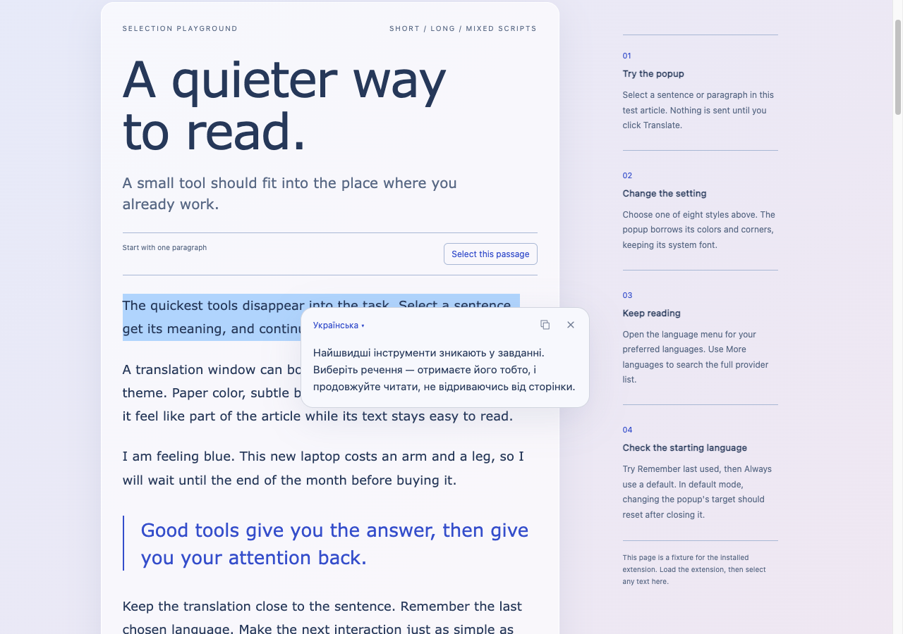
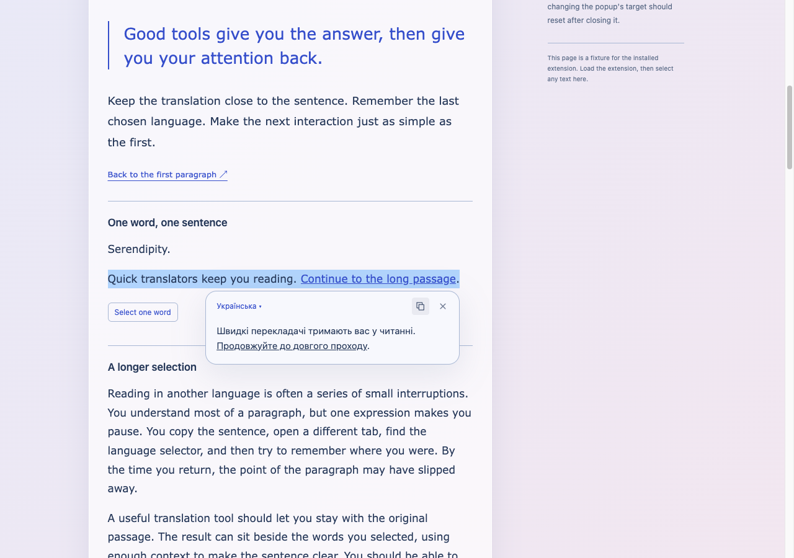
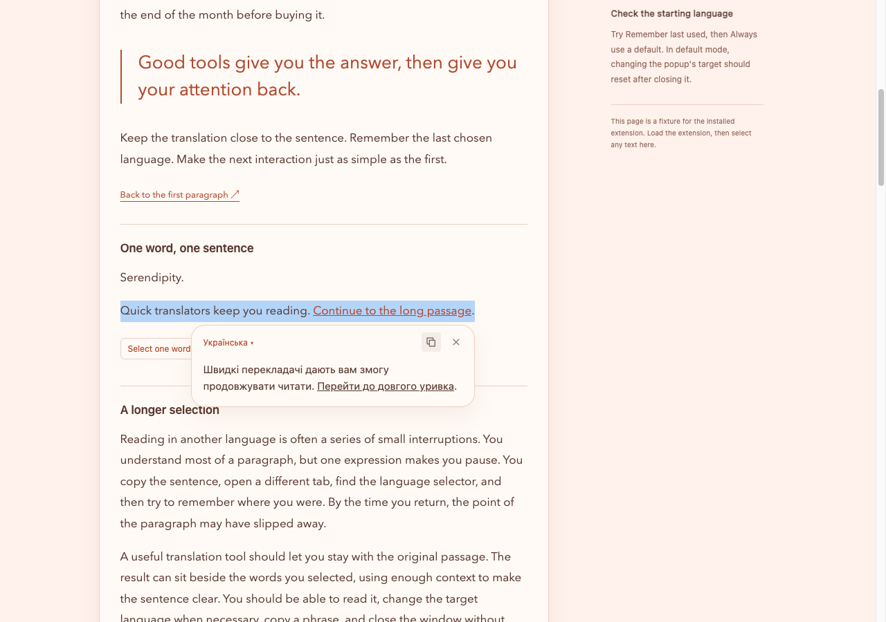
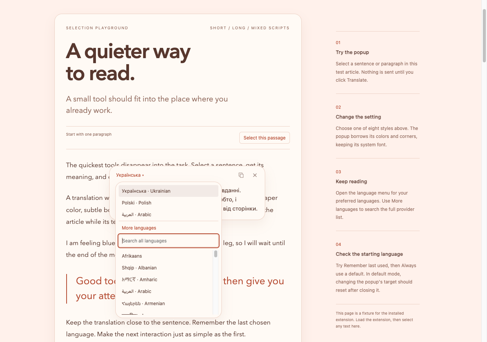

# Movable window and underlining verification

Verified on 2026-10-04 in isolated Helium profiles using the unpacked Chromium extension and the live playground.

Drag the empty space in the translation window's top bar to move it. The window stays within a 12 px viewport margin and keeps its manual position while changing the target language. An open language menu follows its button during dragging and browser resizing. Closing the translation ends that placement; the next window opens beside its selection again. Language, copy, and close controls keep their normal behavior.

Underlined links and other selected elements styled with CSS underlining become safe `<u>` markup. Live Azure and DeepL results preserved the underline in the original playground sentence. Link destinations, event handlers, and source styles remain excluded from both the provider payload and rendered translation. The controlled playground regression also verifies nested bold text and surrounding plain text.

## Checks

- `pnpm fix` passed lint, formatting, strict TypeScript checking, all 17 prototype behavior tests, and a credential-free build. `pnpm build:local` restored the private extension build afterward.
- `python3 scripts/check-extension.py` passed 40 checks. New checks cover native mouse dragging, completion of a drag, retaining position through a language change, all four viewport edges, reset on a new popup, language-menu anchoring while dragging, and live underline preservation through both providers.
- The existing resize checks also passed with the manually positioned window and its open language menu at 390 × 520, 320 × 240, and 1280 × 900. The shortest viewport retained a scrollable menu. Deliberate page scrolling still closed both windows.
- The extension checks retained coverage of eight page styles, SF Pro / system typography, both target-language modes, right-to-left output, partial selections, paragraphs, lists, tables, code, and provider filtering.
- `python3 scripts/check-demo.py` passed 19 checks: five with live translations and fourteen with controlled responses. The two new underline checks verify CSS underlining with nested bold text and removal of source attributes. Previous menu, rendering, copying, and selection checks remain covered.

Movement uses native pointer events and pointer capture without a runtime dependency. The browser checks send real mouse input through Chromium's debugging protocol, including a held left button during movement. These runs provide desktop interaction evidence. Translation timings in the result files are individual functional observations.

The shared preview reproduced the missing underline before the fix. It later reported that its automation host was unavailable; the completed results below come from the isolated Helium runs. The existing playground server stayed running throughout.

## Evidence

- [Extension results](extension-results.json)
- [Playground results](demo-results.json)

The translation after moving its window:

An underlined source link remains underlined in an Azure translation:

The same passage through DeepL:

The open language menu follows the moved window:

