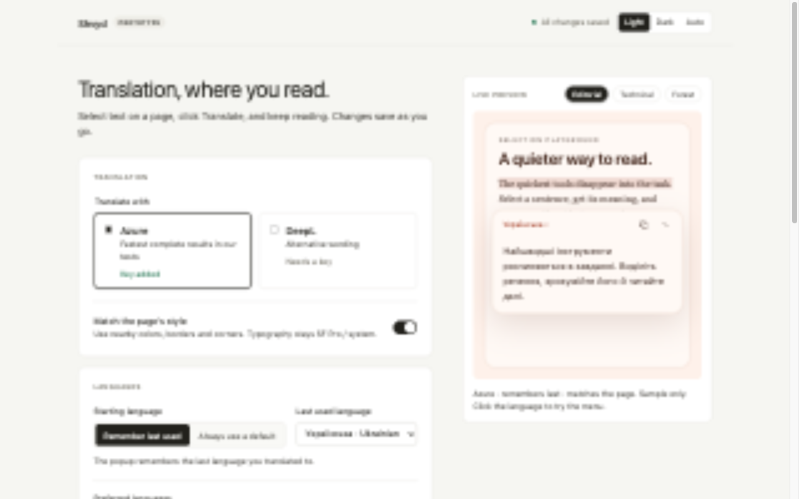
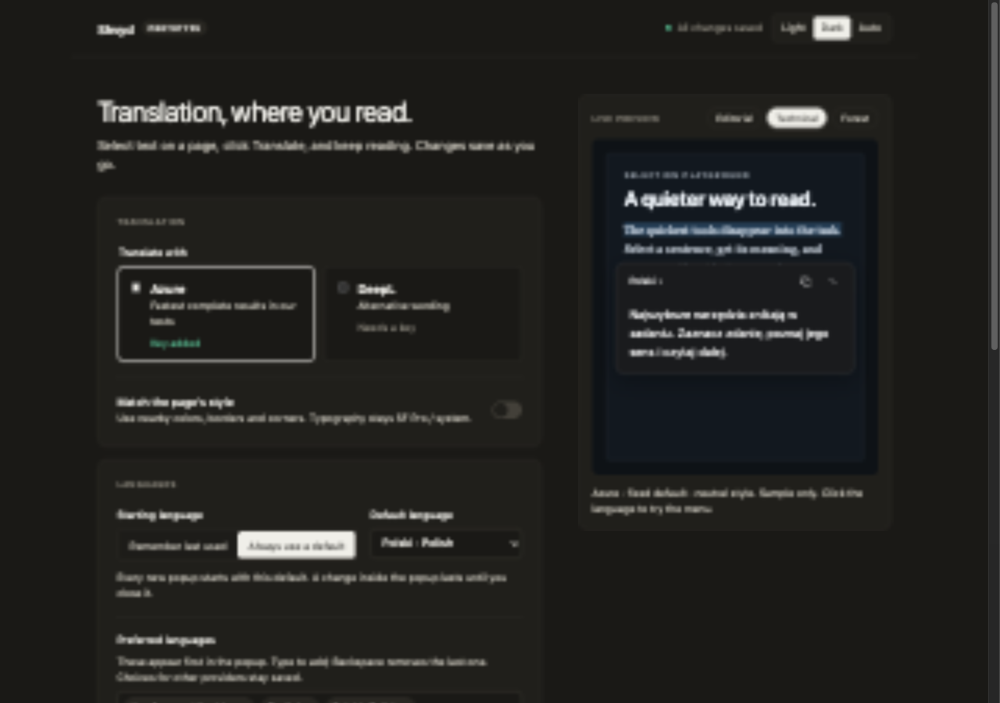
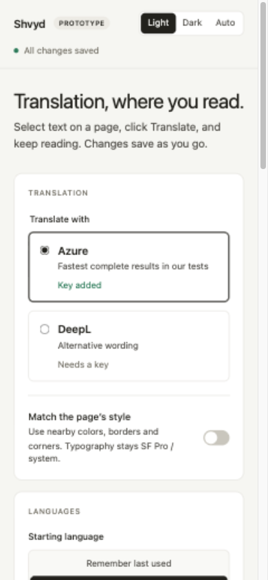

# Cursor settings implementation verification

Verified on 2026-10-06 against the supplied `Settings 1a Cursor.dc.html` design.
The implementation branch starts at `docs/release-plan`, after that branch was
synchronized with the merged prototype on `main`.

## Implemented behavior

- Cursor's warm neutral colors, cards, provider choices, segmented controls,
  language chips, and sticky popup preview. SF Pro / system fonts replace the
  reference's remotely downloaded Inter font.
- Preferences and credentials autosave after 400 ms. Saves run in order and
  coalesce edits while a write is pending. Failed saves retain the draft and
  expose Retry save. Closing with unsaved changes invokes the browser's normal
  leave-page prompt.
- Light, Dark, and Auto settings appearance persists in this extension tab's
  local storage. Auto follows the operating system. This does not change the
  translated popup's page adaptation.
- The full provider catalog remains available. Suggestions show up to six
  matches, and search checks every catalog entry. Choices for other providers
  stay saved. A provider switch reports an unsupported target's fallback.
- Remembered and fixed targets retain their existing semantics. Removing the
  last preferred language is prevented in the new settings UI. The playground
  keeps its existing language-list UI.
- Masked keys, Show/Hide, both official DeepL endpoints, location code, and real
  `.env` import. Import now autosaves, matching the selected design.
- Test connection sends a fresh five-character `Hello` request to the chosen
  provider, targeting Ukrainian. It uses the entered credentials, including an
  inactive provider's key, without changing the active provider. It bypasses
  cached results. The background permits this message only from options.html.
- A saved key is labelled unverified until an explicit test succeeds. Editing
  credentials clears the result, including when a request is still pending.
- Editorial, Technical, and Forest previews use static samples and no API calls.
  Preview language changes are temporary and do not alter saved preferences.
  Languages without prepared sample translations show an explanatory placeholder.
  Copy/close icons in the illustration are decorative, as in the reference.

## Automated checks

- `bun run verify`: lint, formatting, TypeScript, 23 unit tests, credential-free
  build passed.
- `python3 -m pytest scripts/test_benchmark_cloud.py scripts/test_benchmark_opencode_go.py -q`:
  17 tests passed.
- TDD exercised autosave ordering/coalescing and retry after a failed write,
  plus fresh connection requests using the inactive provider's credentials.
  Each new behavior test was observed failing before its implementation.

## Browser and live provider checks

The collaborative browser displayed the bundled options page using an isolated
fixture with dummy credentials and controlled responses. It verified language
search/add, fixed target selection, autosave persistence, storage failure and
retry, connection success/rejection, clearing verification after edits, and
layout at 1280, 390, and 320 pixels. Light and dark screenshots are from this
fixture, so they contain no real keys. The 640-pixel native extension reflow
check covers the layout width available at 200% zoom in a 1280-pixel window;
actual browser zoom was not automated.

The existing Helium harness loaded the actual unpacked extension in a temporary
profile with the configured provider keys:

- `python3 scripts/check-extension.py`: all 40 checks passed, including Azure and
  DeepL translation, formatting, underlines, language persistence, fixed-default
  resets, dragging, and popup placement.
- `python3 scripts/check-extension.py --settings-only`: all 10 focused checks
  passed. Both providers made real connection requests. The saved
  [results](live-settings-results.json) contain status metadata only.
- `python3 scripts/check-demo.py`: all 19 playground checks passed.

The focused harness removes keys and imports dummy credentials only inside its
throwaway profile. It never changes the owner's regular browser settings.
Focused evidence now goes to `.preview/settings-extension-check/` so it does
not overwrite the full extension run's results.

## Screenshots

The narrow and dark captures retain settings changed during interactive checks.
The preview samples and control layout follow the chosen design; the captures
are not screenshots of the original design export.
